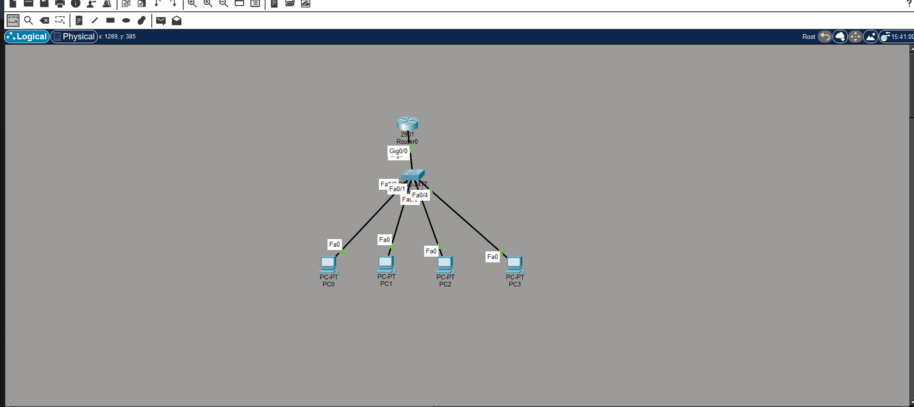
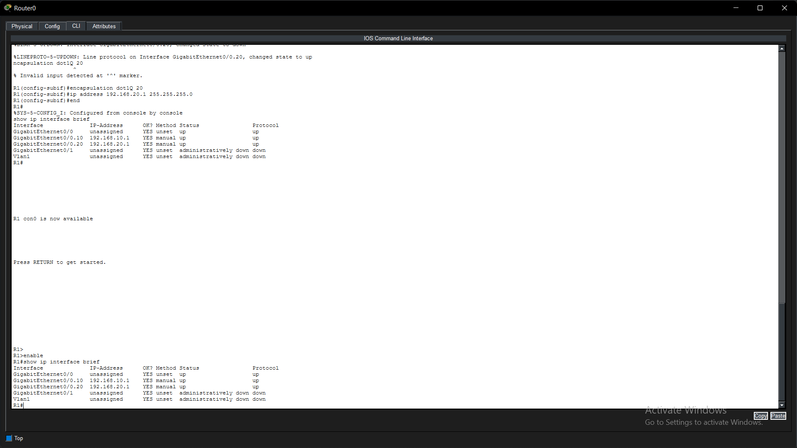
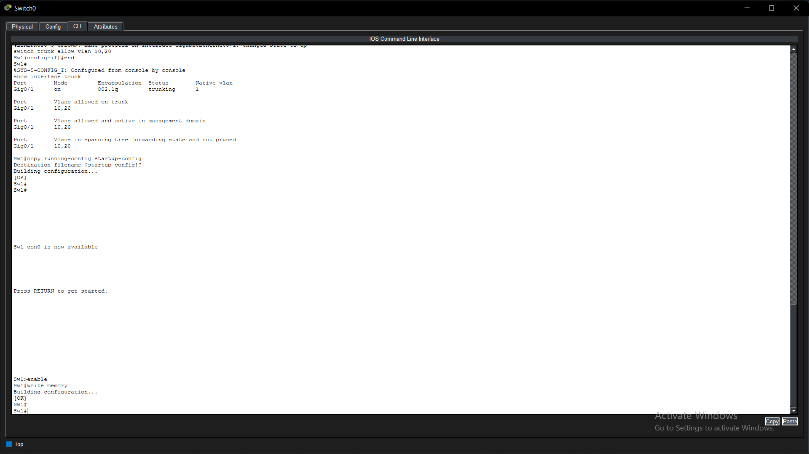
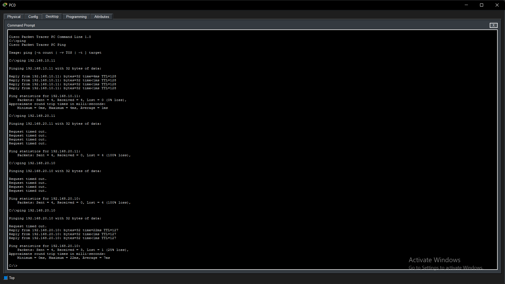

# Lab 02: VLANs and Inter-VLAN Routing (Router-on-a-Stick)

Built in Cisco Packet Tracer.

## Objective

Split one switch into two VLANs, then let the VLANs communicate through a single router using sub-interfaces on a trunk link (router-on-a-stick).

## Topology

- 1 router (Cisco 2901), hostname `R1`
- 1 switch (Cisco 2960), hostname `SW1`
- 4 PCs, two per VLAN
- Router `Gi0/0` connects to switch `Gi0/1` (trunk)
- PCs connect to switch `Fa0/1` to `Fa0/4` (access ports)

## Addressing

| Device | VLAN | Switch port | IP address | Default gateway |
|---|---|---|---|---|
| PC0 | 10 (SALES) | Fa0/1 | 192.168.10.10 | 192.168.10.1 |
| PC1 | 10 (SALES) | Fa0/2 | 192.168.10.11 | 192.168.10.1 |
| PC2 | 20 (HR) | Fa0/3 | 192.168.20.10 | 192.168.20.1 |
| PC3 | 20 (HR) | Fa0/4 | 192.168.20.11 | 192.168.20.1 |

Router sub-interfaces:

| Sub-interface | VLAN | IP address |
|---|---|---|
| Gi0/0.10 | 10 | 192.168.10.1/24 |
| Gi0/0.20 | 20 | 192.168.20.1/24 |

## Configuration summary

**Switch (SW1)**
- Created VLAN 10 (SALES) and VLAN 20 (HR)
- Fa0/1 to Fa0/2 as access ports in VLAN 10
- Fa0/3 to Fa0/4 as access ports in VLAN 20
- Gi0/1 as an 802.1Q trunk, allowing VLANs 10 and 20 only

**Router (R1)**
- Enabled `Gi0/0` with `no shutdown` (no IP on the physical port)
- One sub-interface per VLAN, each with `encapsulation dot1Q <vlan>` and the VLAN's gateway address
- 

Full configs: [`SW1-config.txt`](SW1-config.txt) and [`R1-config.txt`](R1-config.txt)

## Verification

From PC0:

- `ping 192.168.10.11` (same VLAN): 4/4 replies
- `ping 192.168.20.10` (different VLAN, through the router): 4/4 replies, TTL=127

TTL 127 instead of 128 shows the packet crossed one router hop, which confirms inter-VLAN routing works.

Useful commands: `show vlan brief`, `show interfaces trunk`, `show ip interface brief`

## Troubleshooting notes

- **Cross-VLAN ping timed out at first.** `show interfaces trunk` returned nothing. The trunk had been configured on `Fa0/24`, but the router cable was plugged into `Gi0/1`. Configuring the trunk on the port actually connected to the router fixed it.
- **First ping of a series sometimes times out.** This is the ARP lookup, and later pings succeed.
- **Config lost after a reload.** Running configs must be saved with `write memory` or `copy running-config startup-config`.

## What I learned

- Access ports carry one VLAN for end devices, trunk ports carry many VLANs between network devices
- A router can serve several VLANs over one cable using sub-interfaces
- The sub-interface number is a label, and `encapsulation dot1Q` is what ties it to a VLAN
- Always verify which physical port a cable is in before configuring it

## Files

- `LAB 02.pkt`: Packet Tracer file
- `topology.png`, `ping-test.png`: screenshots
- `SW1-config.txt`, `R1-config.txt`: device configs
